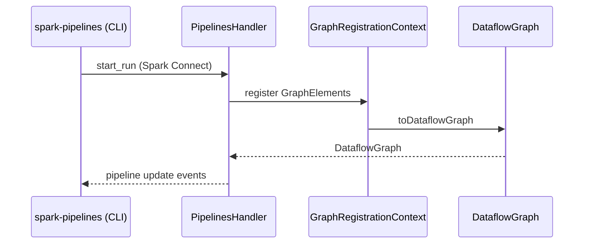

# Dataflow Graph

**Dataflow Graph** ([DataflowGraph](DataflowGraph.md)) is a graph of tables, sinks, views, and flows in a Spark Declarative Pipelines project.

A Dataflow Graph is created every time the [Spark Pipelines CLI](../cli/index.md) (`spark-pipelines`) [runs a pipeline update](../cli/cli.md#run), whether with the `run` or the `dry-run` option.

The CLI uses Spark Connect to talk to [PipelinesHandler](../spark-connect/PipelinesHandler.md), which [runs the pipeline update](../spark-connect/PipelinesHandler.md#startRun).



`PipelinesHandler` logs the following INFO message:

```text
PipelinesHandler: Start pipeline cmd received: start_run {
  dataflow_graph_id: "..."
  full_refresh_all: ...
  dry: ...
  storage: "..."
}
```

`PipelinesHandler` uses [GraphRegistrationContext](../spark-connect/GraphRegistrationContext.md) to register [GraphElement](GraphElement.md)s and, finally, to [build the DataflowGraph](../spark-connect/GraphRegistrationContext.md#toDataflowGraph).
